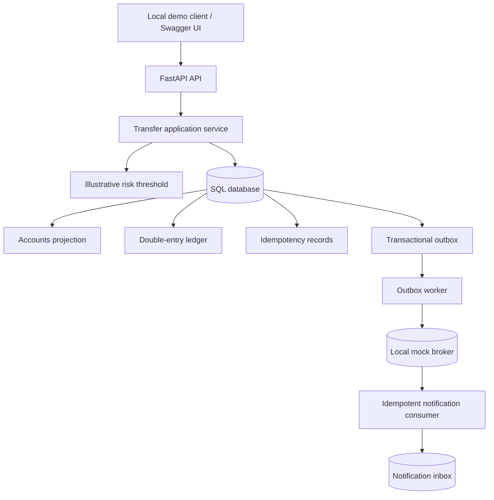
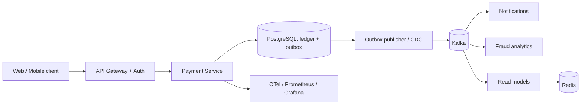

# BankCore 🏦 — Distributed Banking System Design Lab

**Portfolio-ready system design + executable banking *simulation*.** This repository teaches how to design an internal money transfer core with transactional consistency, replay protection, a double-entry ledger, a transactional outbox, and idempotent downstream consumers.

[](https://github.com/Maria091/bankcore-distributed-banking-system/actions/workflows/ci.yml)

> **Version 0.1 / Status: local prototype**. All accounts, funds and payment events are artificial. This is **not a bank**, not production-ready, not connected to a payment network, and not authorized to handle real money, credentials, or PII. Do not deploy to the public internet. The repository URL and badge will become active *after* publication to GitHub.

## What is actually implemented

- FastAPI REST endpoints for synthetic account creation, funding from a fixed demo treasury, account balances, transaction history and transfers.
- Immutable ledger entries for each posted transfer (**one debit + one credit**, integer cents); indexed account balance projections updated atomically.
- Required `Idempotency-Key` for money-moving operations; same request returns same transfer, conflicting reuse is rejected.
- SQLite local mode with serialized database transactions; SQLAlchemy models include PostgreSQL `FOR UPDATE` locking when using that optional backend.
- Demonstration fraud control: transfers **at or above $10,000** are `REVIEW_REQUIRED` and do not move funds. This is a fixed rule, **not ML**.
- Transactional outbox, database-backed mock message broker, deduplicating notification consumer, one-shot worker.
- Pytest API, financial invariants, concurrent overdraft, failed-transfer and outbox/deduplication tests; GitHub Actions config.
- Standalone ledger reconciliation command that detects balance/ledger mismatches.
- Optional PostgreSQL + API Compose file (**not yet runtime-verified in this environment**).

## Architecture overview



The architecture intentionally starts as a **modular monolith** with strong database consistency; future work separates services and introduces Kafka without distributed money-write transactions.

## Run for free (SQLite, no Docker)

Requirements: **Python 3.10+**. From the repository root:

```bash
python -m venv .venv
source .venv/bin/activate  # Windows PowerShell: .venv\Scripts\Activate.ps1
python -m pip install -e '.[dev]'
pytest -q
python scripts/demo.py
uvicorn bankcore.api:app --host 127.0.0.1 --port 8000
```

Open **http://127.0.0.1:8000/docs** for interactive OpenAPI documentation. The default **local demo** key is `local-demo-key-only`; enter it as `X-API-Key` on operations. *Do not use it to secure any exposed server.*

### Quick transfer using curl

Create two synthetic accounts:

```bash
curl -X POST http://127.0.0.1:8000/v1/accounts \
  -H 'X-API-Key: local-demo-key-only' -H 'Content-Type: application/json' \
  -d '{"owner_label":"Demo Alice"}'
curl -X POST http://127.0.0.1:8000/v1/accounts \
  -H 'X-API-Key: local-demo-key-only' -H 'Content-Type: application/json' \
  -d '{"owner_label":"Demo Bob"}'
```

Copy the returned `id`s into these example requests:

```bash
curl -X POST http://127.0.0.1:8000/v1/demo/fund \
  -H 'X-API-Key: local-demo-key-only' -H 'Idempotency-Key: fund-alice-001' \
  -H 'Content-Type: application/json' \
  -d '{"account_id":"REPLACE_ALICE_ID","amount_minor":20000}'

curl -X POST http://127.0.0.1:8000/v1/transfers \
  -H 'X-API-Key: local-demo-key-only' -H 'Idempotency-Key: transfer-001' \
  -H 'Content-Type: application/json' \
  -d '{"source_account_id":"REPLACE_ALICE_ID","destination_account_id":"REPLACE_BOB_ID","amount_minor":7500,"reference":"Synthetic transfer"}'
```

`20000` means $200.00 and `7500` means $75.00. We use integer minor units to avoid floating-point money errors.

Run the simulated outbox dispatcher and message consumer (after making transfers):

```bash
python -m bankcore.worker
python scripts/reconcile.py  # check ledger / balance invariants
```

### Optional local PostgreSQL (Docker required)

```bash
docker compose up --build -d
# API: http://127.0.0.1:8000/docs
# after sending demo transfers:
docker compose run --rm api python -m bankcore.worker
# stop and remove ephemeral containers:
docker compose down
```

PostgreSQL uses Docker Compose's development-only password. Never use the compose file in production. Kafka, Redis, fraud ML, and cloud deployments are **future** phases; they are not running in v0.1.

## Core invariants

1. **Never overdraft:** atomic balance check + debit/credit inside a database transaction.
2. **Every posted transfer balances:** two ledger entries with amounts `-n` and `+n`, summing to zero.
3. **Retry-safe money requests:** keyed request fingerprints and stored responses committed with the ledger.
4. **No phantom event:** the outbox record commits atomically with the transfer.
5. **Risk review moves no funds:** reviewed transfers have no ledger entries.
6. **Global conservation:** the initial synthetic treasury reserve is a **genesis simulation balance**; all subsequent movements preserve the total. It is not represented as a real external deposit or audit-grade opening journal.

## System design documents

| Document | Contents |
|---|---|
| [HLD](docs/HLD.md) | Requirements, C4-style architecture, capacity assumptions and scaling |
| [LLD](docs/LLD.md) | Database design, transaction algorithm, sequences, concurrency and failure cases |
| [API](docs/API.md) | HTTP contracts, examples, status codes and idempotency |
| [Architecture decisions](docs/ADRs.md) | Modular monolith vs microservices, SQL vs NoSQL, async messaging |
| [Testing strategy](docs/TESTING.md) | Coverage, invariants, chaos tests and next benchmarks |
| [Threat model](docs/SECURITY.md) | Gaps, realistic production controls and safe demo scope |
| [Roadmap](docs/ROADMAP.md) | Practical free-first milestones and explicit non-implemented features |

## Architecture evolution (planned, not delivered)



**Next steps:** true Postgres integration tests, a durable Kafka-based outbox relay, observable retry and DLQ flows, fraud policy adapter, rate limits and identity, load tests, deployable environment, monitoring dashboards, and documented quantitative benchmarks.

## Portfolio-friendly truthful statement

> Designed and implemented a local banking transfer simulator using Python, FastAPI, SQLAlchemy, and SQLite, with double-entry accounting, transaction-level idempotency, outbox events, API tests, and concurrent overdraft prevention. Documented a PostgreSQL/Kafka scale-out architecture; cloud streaming deployment is planned.

## License

MIT. Educational use only; absolutely no real funds, payment cards, customer data, or banking access.