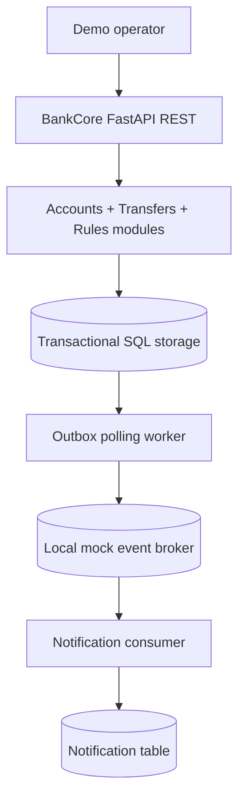
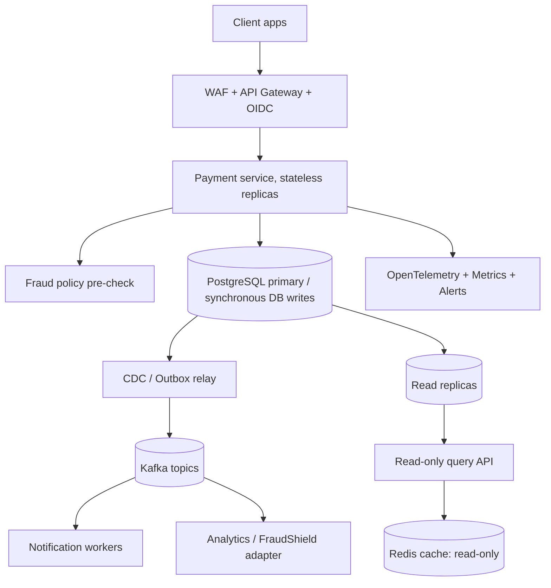

# BankCore — High-Level Design (HLD)

**Scope:** Simulated internal USD transfers between accounts. **Version:** v0.1, 2026-11.  **Trust level:** local development only.

## 1. Problem statement

Demonstrate the design of a payment core in which concurrent requests, network retries, and asynchronous notifications do not corrupt the financial ledger. The exercise prioritizes correctness and explainable failure handling over shipping many services. No connection to financial institutions, card networks, personal identity, or real funds.

## 2. Functional requirements

| ID | Requirement | v0.1 status |
|---|---|---|
| F1 | Create synthetic USD account and view balance | Implemented |
| F2 | Move synthetic funds from demo treasury to account | Implemented (not a real deposit) |
| F3 | Transfer between accounts, rejecting overdrafts | Implemented |
| F4 | Query transfer and account ledger | Implemented |
| F5 | Client-generated idempotency keys | Implemented |
| F6 | Risk-based hold on large transfers | Simple rule only |
| F7 | Commit outbox messages alongside money writes | Implemented |
| F8 | Publish events to Kafka, support at-least-once delivery | **Planned**; DB mock only |
| F9 | Notify customers and provide full audit trail | Mock inbox only |
| F10 | Authentication, sanctions/compliance, settlement network | **Out of scope** |

## 3. Non-functional requirements / target envelope

| Category | Design target, NOT measured |
|---|---|
| Correctness | No lost/created funds for posted transfers; ledger debit and credit sum to zero |
| Durability | Once committed, money state survives application crash (depends on database configuration) |
| Idempotency | Safe retries for money-moving endpoints for a retained idempotency key |
| Performance | Illustrative future goal: 500 transfers/s sustained, p95 < 250 ms on provisioned hardware |
| Availability | Future HA target 99.9% API availability; no uptime SLA for local demo |
| Observability | Logs, metrics, traces and audit events in subsequent milestone |
| Security | Least privilege, TLS, OAuth/OIDC, mTLS/internal ACLs in future hosted deployment |
| Data retention | Immutable entries and compliance-specific retention to be defined with a real bank |

Traffic planning example: 500 transfers/s * 86,400s ≈ **43.2m/day** at continuous peak; actual peak/average ratios must be modeled. At ~2 ledger writes + 1 transfer + 1 idempotency + 1 outbox per posted transfer, assume at least 5 core logical writes/transfer (not counting indexes), and size partitions/IO based on measured physical workload. This is only a capacity exercise, **not tested throughput**.

## 4. Context / boundaries

### Current deployment

Local Python API, SQLite file DB, background worker invoked manually or by a script. SQLite writers serialized to defend the critical section in concurrent local tests. This is one app plus one process, **not a distributed production deployment**.

### Future deployment

**Do not split the debit and credit across independent services.** Both changes must remain in one transaction/ledger authority. If multi-bank or cross-ledger transfers are introduced, require clearing accounts and an explicit saga/settlement protocol rather than relying on distributed transactions.

## 5. Core API surfaces

- Account write/read: `POST /v1/accounts`, `GET /v1/accounts/{id}`
- Ledger and transfer read: `GET /v1/accounts/{id}/ledger`, `GET /v1/transfers/{id}`
- Demo funding: `POST /v1/demo/fund` (artificial treasury)
- Money transfer: `POST /v1/transfers`
- Health: `GET /health/live`, `GET /health/ready`; restricted counters: `GET /v1/ops/stats`
- All operations except liveness require demo `X-API-Key`; transfers/funding additionally require `Idempotency-Key`.

OpenAPI contract: [API.md](API.md) and [openapi.json](openapi.json).

## 6. Critical flows

1. Client submits transfer with unique idempotency key.
2. App begins DB transaction, takes appropriate row/transaction lock, checks stored key, then reads both accounts.
3. Validates USD, active status, sufficient funds; a fixed large-amount risk rule requests manual review.
4. On posted transfer, writes one transfer record, two balanced entries, updates balances and writes outbox event **in the same transaction**.
5. Stores idempotency response in the same transaction and commits.
6. Outbox worker later publishes to mock broker; notification consumer dedupes by event ID.

Critical order: a failure before commit rolls everything back. A failure after commit but before publication leaves an outbox event for retry. Network response loss allows the client to safely retry with the same key.

## 7. Partitioning, read scale and reliability evolution

- **Write scaling:** initially one transactional PostgreSQL primary for correctness. Partition large ledger history by time/account access pattern only after measuring and preserving uniqueness/constraints.
- **Read scaling:** replica + event-driven projections for statement views, but NEVER authorize a debit solely using stale cached balances.
- **Event scale:** Kafka partitioning by account ID for account-specific event order; cross-account transfer ordering requires explicit ledger transaction IDs and consumer reconciliation.
- **Retry strategy:** persistent outbox + exponential backoff + DLQ + idempotent consumers. Design end-to-end **effectively once** business processing, not global exactly-once delivery.
- **Recovery:** backups and tested PITR, reconciliation jobs, alerting for non-zero ledgers, durable topic retention and dead-letter processing. These are unimplemented.

## 8. Assumptions and exclusions

- Only USD; positive integer cents; no FX, refunds, chargebacks, holds, ACH, wires or overdraft lines.
- Treasury starts with an artificial genesis balance of 100,000,000 cents. The genesis injection is not journaled, so complete accounting for **issuance** is not modeled; subsequent movements always balance.
- A transfer flagged for review is stored but never debited or settled. Manual approval workflow is future work.
- Demonstration `X-API-Key` is shared and known; cannot establish end-user identity or account ownership.
- No claims of real banking compliance or operational SLOs.