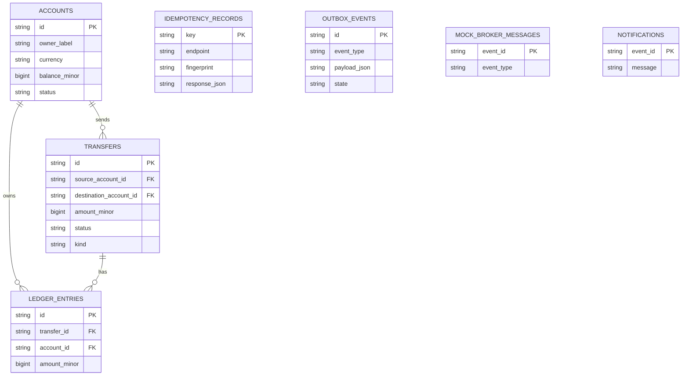
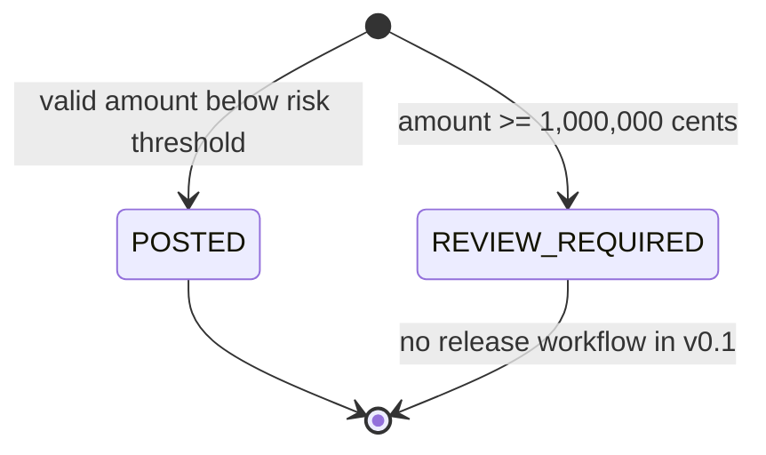

# BankCore — Low-Level Design (LLD)

## 1. Major components

- `api.py`: FastAPI request validation, route-level authentication for local demo, session lifecycle, HTTP error mapping.
- `schemas.py`: Pydantic input and response contracts, integer-cents validation.
- `services.py`: replay protection, account locking, funds check, risk decision and atomic ledger/outbox writes.
- `models.py`: SQLAlchemy ORM mappings for accounts, transfers, entries, idempotency, outbox, mock broker and notification inbox.
- `database.py`: SQLAlchemy engine and demo treasury initialization; SQLite BEGIN IMMEDIATE; SQL row locks for PostgreSQL.
- `messaging.py`: deterministic local publisher and idempotent notification consumer.
- `reconcile.py`: verifies debit/credit matches, account projections, conserved genesis funds and transfer/outbox counts.
- `worker.py`: manual one-shot worker invocation.

## 2. Data model



Actual ORM schema source: [`src/bankcore/models.py`](../src/bankcore/models.py).

### Table constraints and indexes

| Table | Keys/indexes | Intent |
|---|---|---|
| accounts | PK `id`, status CHECK | Current balance projection, one currency per account |
| transfers | PK `id`, source/time index, amount > 0 | Posted/review requests and lookups |
| ledger_entries | PK, `(transfer_id,account_id)` unique, `(account_id,created_at)` index, delta != 0 | Exactly one entry per side in current model |
| idempotency_records | PK `key` | Conflict detection and stable response replay |
| outbox_events | PK `id`, `(state,created_at)` index | Pending event scan |
| mock_broker_messages | PK `event_id` | Stand-in deduplicating event store |
| notifications | PK `event_id` | Consumer-side deduplication/inbox |

`balance_minor` is a **cached transactional projection**. The ledger history is the explanation for changes after simulated genesis; reconciliation should compare current balances to genesis + cumulative entries. Ledger entries must be append-only in a real deployment, enforced using database rights and auditing, not just application convention.

## 3. Transfer sequence

```mermaid
sequenceDiagram
    participant C as Client
    participant API as FastAPI
    participant S as TransferService
    participant DB as SQL DB
    participant W as OutboxWorker
    C->>API: POST /v1/transfers + Idempotency-Key
    API->>S: Validate and transact
    S->>DB: BEGIN + lock / serialize
    S->>DB: Lookup idempotency key and fingerprint
    alt identical request already applied
        DB-->>S: Stored response
        S-->>C: Same response; no new debit
    else new request
        S->>DB: Lock accounts in stable ID order
        S->>DB: Validate funds and rule decision
        alt review required
            S->>DB: Store REVIEW_REQUIRED transfer, no ledger entries
        else approved
            S->>DB: Update both balances + append debit/credit entries
        end
        S->>DB: Insert outbox + idempotency response
        S->>DB: COMMIT
        S-->>C: 201 with transfer ID and status
        W->>DB: Read committed PENDING outbox
        W->>DB: Mock publish + mark PUBLISHED
    end
```

## 4. Exact money-transfer algorithm

```text
BEGIN TRANSACTION
  if PostgreSQL: acquire account row locks in ascending account ID order
  if SQLite: BEGIN IMMEDIATE serializes local writers
  find idempotency(key)
  if found and (endpoint, SHA256(canonical JSON)) match: return stored response
  if found and payload differs: HTTP 409
  reject same source/destination, missing/frozen/currency mismatch
  verify source balance >= integer amount_minor
  if risk threshold triggered:
      insert transfer REVIEW_REQUIRED
      do NOT create ledger entries or mutate balances
  else:
      update source balance -= amount_minor
      update destination balance += amount_minor
      insert transfer POSTED
      insert debit -amount and credit +amount ledger rows
  insert corresponding outbox event
  insert idempotency key + fingerprint + replay response
COMMIT
```

PostgreSQL-specific caution: initial v0.1 code uses a unique idempotency key and row locks; truly simultaneous **same-key first requests on PostgreSQL** require explicit key-level serialization or conflict/retry handling. SQLite serializes the entire local transaction and this path is exercised by tests. Do not claim PG concurrent-request safety as fully verified before implementing and testing that mechanism.

## 5. State machine



No manual review/settlement transition is implemented. Adding an approval endpoint must enforce permissions, idempotency and a distinct settlement transaction; changing status alone is unsafe.

## 6. Event contracts and consumers

Examples:

```json
{"event_type":"transfer.posted","payload":{"id":"uuid","source_account_id":"uuid","destination_account_id":"uuid","amount_minor":7500,"status":"POSTED","kind":"TRANSFER","reference":"Synthetic transfer"}}
```

The event also has a unique `outbox_events.id` used as the `event_id`. The mock broker uses `event_id` as primary key, and the consumer uses `notifications.event_id` as primary key. Duplicated publication therefore cannot duplicate *this local database notification*. The real Kafka adapter will require persisted offset/inbox tracking and retriable external side effects.

## 7. Failure-handling matrix

| Failure point | Expected handling |
|---|---|
| Invalid amount / currency | 422 before money movement |
| Insufficient funds | 409; rollback; no ledger/outbox |
| Same account | 422; rollback |
| Same key + different payload | 409; do not debit |
| App crashes before commit | DB rolls back |
| App crashes after commit / response lost | Client retry returns cached transfer |
| Worker unavailable | PENDING outbox event remains for retry |
| Duplicate event delivery | Consumer inbox dedupes using event ID |
| Database down | No write is acknowledged; retry behavior after recovery requires client key reuse |

## 8. Concurrency and account locking

SQLite: `BEGIN IMMEDIATE` before SQL operations serializes write transactions, protecting the balance check/update from local double-spend race. It also serializes reads and therefore does not scale horizontally; this is an educational trade-off.

PostgreSQL: `SELECT ... FOR UPDATE` over account IDs in lexical order, so two transfers touching the same accounts lock in the same sequence and avoid basic lock inversion. Production needs deadlock retry handling, serializable/idempotency integration tests, database durability config, and advisory or reservation locks on identical keys.

## 9. Next technical refinements

- Replace artificial treasury genesis with journaled opening capital/equity ledger.
- Add immutable ledger rules enforced in DB (no DELETE/UPDATE, append-only roles).
- Add audit log, account ownership and authN/authZ, comprehensive replay protection.
- Add proper idempotency TTL/archive policy, request-scoped auth identity and quotas.
- Add Kafka outbox relay, retry/backoff/dead letter and crash injection.
- Add PostgreSQL migration tool (Alembic) and integration test matrix.